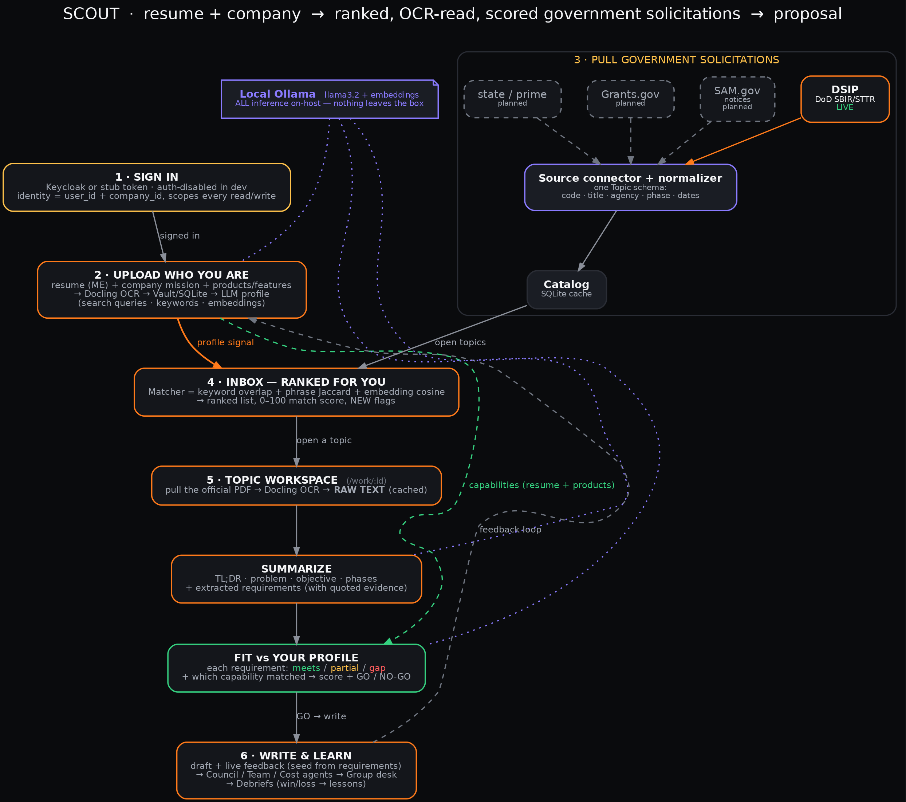

# Workflows

How the pieces connect, start to finish. Diagram: [`scout-workflow.png`](scout-workflow.png).



---

## 1. Sign in

- **Dev (default):** `AUTH_DISABLED=true`, so the UI auto-enters as **Dev @ anthracite**. Switch
  people at `/login` or **Company → switch**.
- **Prod:** Keycloak issues a JWT. The backend verifies it **locally** (RS256 signature + exp +
  issuer + audience) against the cached realm JWKS — no per-request round-trip. Identity
  (`user_id`, `company_id`, `groups`) comes from the verified claims. See
  [`topic-intelligence.md`](topic-intelligence.md#auth) and
  [`../architecture/auth-and-storage.md`](../architecture/auth-and-storage.md).

## 2. Set up your profile

- **Profile** → upload your resume, marked **ME** (tools *you* have hands-on used).
- **Company** → mission + products (shared by the whole org).
- Together these form the **capability text** used to score fit and run the Council. If no
  resume is on file, SCOUT seeds an Anthracite capabilities pack so ranking still works.

## 3. Inbox ranking (automatic, cheap)

1. Backend extracts search terms from your resume/company pack.
2. Queries open + pre-release **DSIP** topics (public API, proxied).
3. Ranks by keyword/embedding overlap — **score high-to-low, not a cutoff** (anyone can bid
   anything).
4. The Inbox shows ranked cards, a match breakdown, and the Opportunity map scatter.

No LLM council here — this runs on a timer and after login, and it's safe to run often.

## 4. Dig into one topic (Workspace)

Open a topic's **Workspace** (`/work/:id`). On demand it builds a chain, each step cached:

```
DSIP PDF ──Docling OCR──▶ raw text ──LLM──▶ summary (requirements + evidence)
                                   │
                        your resume + company pack
                                   │
                                   ▼
                      Fit: requirement-by-requirement
                      (meets / partial / gap) + GO/NO-GO + 0–100
```

- **text + summary are shared** (identical for everyone → computed once, reused org-wide).
- **fit is private** (scored against your profile → stored per-user, you only see your own).
- The **Reader** tab links each requirement back to the exact OCR sentence it came from.

Details: [`topic-intelligence.md`](topic-intelligence.md).

## 5. Council (optional deep pass)

When a topic is worth it, run the **Council** (`/analysis`, or from a card). The agent roster
each weighs in, and a Chair synthesizes a **0–100 fit + GO / NO-GO**. Cached in the vault, so a
re-open is free. This is the only expensive step and it's always explicit.

## 6. Track it (Pipeline)

Add the topic to the **Pipeline** (`/tracker`) and move it through bid stages. This also creates
the per-bid vault space the Team room and proposal writing use.

## 7. Write the proposal

- **Proposals** (`/proposals`) — draft with live LLM feedback; chat with individual personas in
  a recorded working log; run a full review (uses the topic + past debriefs).
- **Team room** (`/desk`) — shared `proposal.md` for the company. Two+ writers get overlap
  detection on their approach cards so you don't duplicate effort. Private drafts stay private;
  teammates only see *that* a draft/Flint run exists.

## 8. Learn from losses (Debriefs)

Lost a bid? Upload the government feedback in **Debriefs** (`/debriefs`). Docling OCRs it and the
LLM distills reusable lessons that future reviews pull in.

---

## Where state lives

| State | Where |
|-------|-------|
| DSIP topic data (cached) | SQLite + `sbirs/{id}/…` in the vault |
| OCR text + summary (shared) | vault `sbirs/{id}/intel/` |
| Personal fit (per-user) | vault `sbir/{id}/{company}/users/{you}/fit.json` |
| Council / Flint runs | vault pointers → immutable `blobs/{sha}.json.gz` |
| Shared proposal | vault `sbir/{id}/{company}/shared/proposal.md` |
| Resume / company pack | vault `users/{you}/me.md`, `companies/{id}/mission.txt`,`products.md` |

The vault is disk (`/data/vault`) in dev and S3/SeaweedFS in prod. Full layout:
[`../architecture/auth-and-storage.md`](../architecture/auth-and-storage.md).
